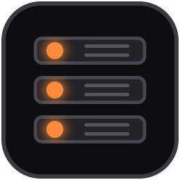

# devstack

A personal, portable Laragon-style dev environment for Windows 10/11, written in Rust.
Tray icon + window + command line. Apache or Nginx, PHP, Python, Node.js, MySQL/MariaDB,
PostgreSQL, MongoDB, Redis, Memcached, Mailpit; every folder in `www\` becomes
`https://name.test` with a trusted certificate.

Several versions of each can sit side by side (switch with the Version dropdown):

| Tool | Versions on the Install page |
|---|---|
| PHP | 8.5, 8.4, 8.3, 8.2, 8.1, 8.0, 7.4, 7.3, 7.2, 7.1, 7.0 |
| Python | 3.15, 3.14, 3.13, 3.12, 3.11, 3.10, 3.9, 3.8 (full Python with pip and venv) |
| MySQL | 26.10 Innovation, 9.7 LTS, 8.4 LTS, 8.0, 5.7, 5.6 |
| MariaDB | 12.3, 11.8, 11.4, 10.11, 10.6 (all LTS) |
| PostgreSQL | 18, 17, 16, 15, 14, 13 |
| MongoDB | newest, 8.0, 7.0, 6.0 |
| Node.js | current LTS, 26, 24, 22, 20, 18, 16 |
| Composer | latest, and 2.2 LTS (used automatically with PHP 7.0/7.1) |

New releases show up on their own. Patch releases (PHP 8.4.x, Node 22.x, MySQL 8.4.x, …) are
always the newest when you install. New series (PHP 8.6, Python 3.16, Node 28, MariaDB 13,
PostgreSQL 19, Laravel 14, …) are found once a day, or right away with Install > Check for new
versions (`ds discover`). The one exception is a new MySQL Innovation series, which needs a
devstack update.

Each MySQL/MariaDB series keeps its own data folder, so switching versions never touches
another version's databases. MySQL 5.6 needs the Visual C++ 2010 runtime (`ds doctor` says
so if it's missing).

## Install

Run `devstack-setup-<version>.exe`:

1. Pick a folder (default `C:\devstack`; anywhere you can write, not Program Files).
2. Pick what to download now: Recommended = Apache, PHP 8.4, MySQL 8.4, Mailpit, Composer,
   phpMyAdmin. Anything else can be added later on the **Install** page.
3. Optional: desktop icon, add tools to PATH, run at Windows startup.

The installed folder contains only `devstack.exe`, `ds.exe` and the uninstaller. Everything
else (`bin`, `www`, `data`, `etc`, `logs`, …) is created next to them when needed. Quit
Laragon first if it's running; both want ports 80, 443 and 3306.

## Coming from Laragon

devstack can work with the Laragon you already have, in place, without copying anything:

* **Projects:** Laragon's `www` becomes the projects folder.
* **Versions:** Laragon's PHP, MySQL/MariaDB, Node.js, Python, Apache and Nginx show up next
  to devstack's own (marked "Laragon"). devstack never writes into Laragon's folders; its
  settings for Laragon's PHP live in devstack's `etc\php\`.
* **Databases:** each MySQL/MariaDB version opens Laragon's data folder for that version
  (Laragon's `mysql-8` holds 8.0). A version Laragon has no folder for gets a new, empty one
  in devstack's own `data\` folder.

On first launch devstack offers this if it finds Laragon; later it's in **Settings > Laragon**
(or `ds laragon on`, `ds laragon off`, `ds laragon`). Two rules keep your data safe:

* Don't run Laragon and devstack at the same time (same ports, same database folders).
* Only Laragon's own MySQL/MariaDB builds open Laragon's databases. A newer build would upgrade
  the files and Laragon's older build might then refuse them; allow that under Settings >
  Laragon if you don't plan to go back.

If your Laragon databases have a root password, tell devstack: Databases > Root password >
**Enter existing…** (`ds db known-password …`).

## First run

1. Open devstack, click **Start all**. Windows asks once to edit the hosts file.
2. **Tools > Trust the local CA** so HTTPS works without browser warnings.
3. Create a folder in `www\`, or use **New project**. `www\blog` becomes https://blog.test.

The window has a sidebar (Overview, Sites, New project, Install, PHP, Databases, Tools, Logs,
Settings); right-clicking the tray icon gives the same actions while the window is hidden.

## Everyday use

| Want to… | Do |
|---|---|
| New project | New project page: Laravel (latest or 11/10/9/8/6/5.5) / WordPress / Symfony / Django / Flask / … |
| Django or Flask | New project makes the project with its own `.venv`, starts the dev server in a console window (`run.bat` starts it again later) and https://name.test forwards to it |
| Switch PHP / MySQL / Node version | Version dropdown on the Overview, or the Install page ("Use this one") |
| Serve a project from another folder | By default a project is served from `public\` if it has one, else from its own folder. If `index.php` lives elsewhere (`www\shop\another_folder\index.php`): Sites > **Settings** on the project > Web folder, or `ds project root shop another_folder`. The Sites page points it out when it finds an index file in a subfolder |
| Give a project its own versions | Sites > **Versions** on the project (e.g. PHP 7.4 + MySQL 5.7, or Node 18), then pick it in Overview > **Project** (or the tray's Project menu, or `ds project use shop`). Start all then uses its versions; "Default versions" goes back to yours |
| Toggle a PHP extension | PHP page > Extensions |
| php/composer/node/mysql in any terminal | Tools > PATH > Add |
| Terminal with everything on PATH | Overview > **Terminal** |
| See caught emails | Overview > **Mail inbox** (Mailpit) |
| Show a site to someone | Sites > Share (needs an ngrok authtoken in Settings) |
| Open sites from your phone on the same Wi-Fi | Tools > Other devices on your network (`ds lan on`). Off by default, so nobody else on the network can see your projects |
| Back up / restore databases | Databases page |

Command line: `ds start`, `ds stop`, `ds reload`, `ds status`, `ds new Laravel shop`,
`ds use php php-8.4.27-ts`, `ds add php-8.5`, `ds db backup`, `ds lan on`, `ds doctor`, `ds --help`.
Projects: `ds project` (list), `ds project set shop php php-7.4.33-ts`, `ds project use shop`,
`ds project use none`. New versions: `ds discover`.

Installing a version never switches to it; pick it in the Version dropdown
(or `ds use`) when you're ready.

## Security

devstack is a development tool, set up so that nothing is reachable from outside this
computer unless you ask for it:

* Web servers, databases, caches and mail listen on 127.0.0.1 only. **Tools > Other devices on
  your network** opens the web servers to your network; then anyone on it can browse
  everything in `www` at this computer's IP address (`.env`, `.git` and other dotfiles are
  never served, phpMyAdmin and phpinfo stay local).
* The catch-all `localhost` site only answers to `localhost`, this computer's name or an IP
  address, so a web page
  can't reach your projects and phpMyAdmin through your browser by pointing its own domain at
  127.0.0.1 (DNS rebinding).
* The local certificate authority can only vouch for your local names (`.test`, `localhost`,
  your own host names) and 127.0.0.1. Its key is a plain file in `etc\ssl\ca\`; even copied,
  it can't be used to impersonate real websites to this PC.
* Downloads are HTTPS only (redirects included) and checked against the publisher's checksum
  where one exists. MySQL 8.0+, PHP 7.0-7.3, PostgreSQL, Apache, Nginx, ngrok and VS Code
  publish none that devstack can use.
* The one thing done with admin rights is editing devstack's own block in the hosts file, by
  a helper that accepts nothing but `127.0.0.1 name` lines.

Things to know: databases have no root password until you set one and passwords are stored
unencrypted in `usr\secrets.json`, so any program or Windows account that can read devstack's
folder can use them. On a PC other people log in to, keep devstack inside your user folder
(`ds doctor` tells you if other accounts can change its files).

## Customizing

* Extra settings: `usr\php.ini`, `usr\my.ini`, `usr\redis.conf`, `usr\postgresql.conf`
* Extra Apache/Nginx config: any `*.conf` in `usr\apache\` or `usr\nginx\`
* Per-site options (docroot, aliases, no SSL, another host name): `usr\sites.json`
* Any app server (Django, Flask, Node, …) behind https://name.test: `usr\sites.json` →
  `{"myapp": {"proxy": 3000}}`
* Replace a config template: put your copy in `usr\templates\` (same path as in `assets\templates\`)
* New project recipes: `usr\quickapps.json`; extra Install entries: `usr\packages.json`

## Building from source

Open the folder in VS Code (recommended extensions: rust-analyzer). Then:

* `cargo run --bin devstack`: run the app (data goes to `.\dev-root`)
* `cargo test`: tests
* `scripts\build-installer.ps1`: release build + `dist\devstack-setup-<version>.exe`
  (installs Inno Setup with winget if needed)

Or push to GitHub: `.github/workflows/build.yml` builds the installer and a portable zip and
offers them under the Actions tab.

To publish a release: set `version` in `Cargo.toml`, commit and push, then push the matching
tag (`git tag -a v1.0.0 -m "devstack 1.0.0"`, `git push origin v1.0.0`). The workflow checks
that the tag matches `Cargo.toml` and publishes a GitHub Release with the installer, the
portable zip and `SHA256SUMS.txt`.

`CLAUDE.md` describes the architecture and the remaining Windows checks for Claude Code.
